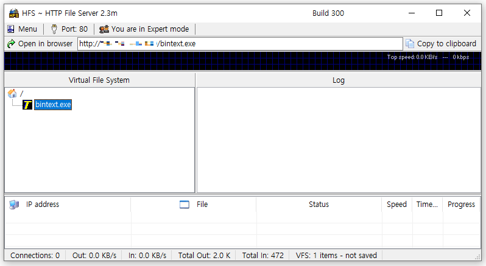
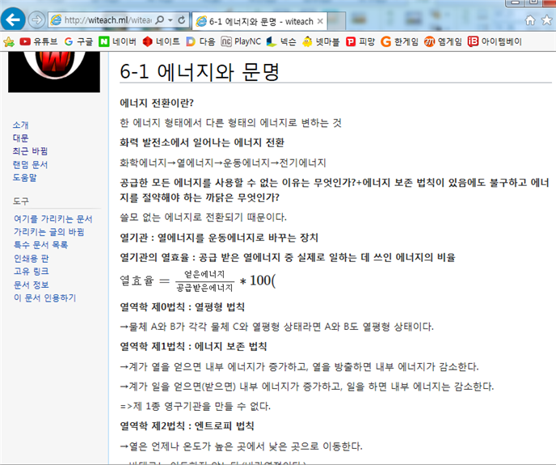

## 초등학생

저도 제 또래의 다른 친구들 처럼 컴퓨터 게임, 닌텐도 DS, 스마트폰이 저의 어린 시절을 차지했습니다.

초등학교 2학년부터 외삼촌과 함께 살게 되었습니다. 그 때 드디어 카트라이더를 할 수 있는 LG Xpion Slim PC(윈도우 Vista 탑재)가 생겼습니다.

그 컴퓨터로 크레이지 아케이드, 카트라이더, 에어라이더, 피파온라인 2, 버블파이터, 마인크래프트까지 정말 많은 게임을 했었네요. 특히 토요일 아침 설레는 마음으로 외삼촌 방에 들어가서 (동생과 번갈아가며) 피파온라인2를 했었던 기억이 있습니다.

저희 부모님은 제가 3학년 때 부터 맞벌이를 하셨는데 그 때부터 집에 혼자있는 시간이 많아졌습니다. 당연히 컴퓨터와 닌텐도를 **많이 많이** 할 수 있었죠.

이 시절 스마트폰과 닌텐도 DS(TT칩과 함께)도 있었기 때문에 정말 많은 것을 해볼 수 있었습니다. 예를 들어 스마트폰 상태바 디자인 바꾸기 위해서 루팅을 하고 커스텀 롬(cyanogen mod)을 설치한다거나, 제가 원하는 NDS 롬파일을 실행시킬 수 있는 TT 칩 커널을 검색해서 추가하거나, PC 윈도우 포맷도(약 10년 뒤, 군대에서도 실컷했습니다) 이 때 처음으로 해봤던 것 같아요.

자연스럽게 기본적인 검색 스킬, 컴퓨터에 대한 이해가 생겼고 무엇보다 **재밌었습니다.**

그리고 드디어 프로그래밍에 입문할 뻔한 순간이 왔었는데... 어디서 보고 갑자기 앱을 만들어보겠다고 자바의 정석 책을 부모님을 졸라서 샀지만, 당연히 그 시절 제 기준으로 너무 어려운 책이었고 결국 지금도 책장속에 고히 모셔두고 있습니다. (첫 프로그래밍은 점프투파이썬 책으로 시작했었네요)

## 중학생

그러다가 시간이 흘러 중학교 2학년 수학시간에 선생님께서 수업 자료를 담은 USB를 가지고 오셨을 때 열린 폴더의 파일 구성을 보고 윈도우 부팅디스크라는 걸 알아차리고 이야기를 하게 됩니다. 수학 선생님께서는 제가 컴퓨터에 관심있는 학생인 것을 알고 예전에는 USB 메모리의 가격이 비싸서 FTP 서버로 파일을 공유했었다는 말씀을 해주셨습니다.

그 내용을 듣고 나서 나만의 파일 서버를 만들고 싶다는 생각이 들었고 (왜 그런지 모르게 할 수 있다는 생각이 들었습니다) 바로 집에 가서 몇 일 동안 구글에 수 많은 검색을 했던 것 같네요. 물론 검색어와 블로그의 글은 저에게 너무 어려웠습니다만 결국 괜찮은 방법을 알게됩니다.

제가 처음 구축했던 파일 서버는 HFS를 활용했습니다. HFS는 GUI 형태로 웹 기반의 파일 서버를 구축할 수 있게 해주는 프로그램입니다.

여름 무렵에는 일반적인 웹사이트를 만들고 싶어졌고 그에 대한 시작으로 간단한 교회 홈페이지를 윈도우 IIS에 워드프레스 기반 웹사이트를 구축했습니다.

DDNS, 포트포워딩, IP 주소가 의미하는 것은 몰랐지만 블로그의 글을 따라 했고 결국 psch.ml 의 도메인을 가진 교회 홈페이지를 가질 수 있었네요.

워드프레스에는 사이트의 레이아웃, 색, 메뉴 방식에 대한 테마가 있습니다. 저는 교회의 대표 컬러를 남색으로 정한다음 이 남색을 적용하고 싶어서 테마 CSS를 열어서 16진수 색 코드를 남색으로 바꾼 것이 기억나네요. 이것이 저에게 있어서 첫 코딩이라고 할 수 있습니다.

물론 교회 홈페이지의 반응은 싸늘했습니다. 그 때 계셨던 교육 전도사님의 조언이 아직도 기억이 납니다. 당시 저희 교인은 노년층이 많기 때문에 사용되기는 어려울 것 같다라는 의견인데 이제와서 생각하니 정확합니다. 현재 있는 홈페이지도 사실상 교회에 대해서 궁금한 외부인 용으로 사용되고 있으니깐요.

지금 돌이켜 생각하면 저 시절에 저는 지금과 달리 훨씬 진취적이고 도전적이었던 것 같습니다.

## 고등학생

그렇게 일반 인문계 고등학교에 진학하게 됩니다. 제가 학교를 다닐때는 문과 / 이과를 선택해야 했는데 저는 대학에서 컴퓨터 관련 전공을 선택하고 싶었습니다. 그래서 과학과 수학을 잘하지는 못했지만 이과를 선택했었네요. (제2외국어는 중국어를 선택했습니다)

고등학생 시절 제가 했던 개발과 관련된 활동은 크게 보면 2가지 였습니다.

먼저 당연히 컴퓨터 동아리에 들어가서 C언어를 배웠습니다. 그 시절 컴퓨터 동아리의 분위기는 정말 자유로웠습니다. 총 2시간으로 이루어진 동아리 시간에 첫번째 한 시간은 C언어를 두번째 시간은 자유시간이었습니다. 등교 후 스마트폰을 제출하면 정규 수업시간이 끝나기 전까지는 세상과 단절됩니다. 그런 단절 속에서 인터넷에 연결된 컴퓨터가 있는 컴퓨터실은 사막의 오아시스 였던 것 같네요. 친구들과 떠들면서 스타크래프트, 수 많은 플래시 게임, 끄투 끝말잇기를 했던 기억은 아직도 잊을 수 없습니다.

2학년때는 컴퓨터 동아리 회장이 되었습니다. (아무도 하고 싶은 사람이 없었기에 무혈입성하게 됩니다) 저는 C언어와 Python을 강의했었습니다. 간단하게 개념을 설명하고 현재는 사라진 구름 IDE를 활용해서 각자 코드를 실행하고 모르는 것이 있으면 제가 도와주는 형태로 했던 것 같습니다. 물론 전통?을 이어받아 나머지 한 시간은 자유시간으로 구성했습니다.

그리고 저희 학교에서는 학생들이 자유롭게 주제를 선택해서 연구를 하고 발표를 하는 과제연구 발표대회를 진행하는 전통이 있었습니다. 저 역시 매년 대회에 참여해서 1학년 때에는 학교 교과 공부를 도울 수 있는 위키 페이지를 만들고, 2학년 때에는 Python으로 교내 보안 점검 자동화 프로그램을 만들었습니다.

이 시절 솔직히 학교 공부보다도 이런 프로그래밍과 개발활동이 좋았습니다. 저는 학교 수업도 충분히 인상적이고 흥미로운 부분이 있었다고 생각합니다. 그렇지만 수업시간에 배웠던 내용이 1 부터 9라는 숫자 등급이 정해지면 어디론가 사라지는 평가 과정은 썩 유쾌하진 않았습니다. 그에 비해 프로그래밍은 자유롭게 제가 원하는 것을 만들 수 있어서 좋았습니다. 그리고 틀려도 수정할 수 있는 기회가 주어지는 것도 매력적이었습니다.

그렇게 대학 진학도 컴퓨터 공학 / 소프트웨어 전공으로 하게 되었습니다.

# 그래서 결론이 뭡니까?

이후 대학생부터 지금까지의 내용도 있지만 여기서 글을 끝 맺으려 합니다.

사실, 지난 DND 활동이 끝나고 매너리즘에 빠졌습니다. 이제는 정말 개발자로 일하기 위해서 회사에 지원해야하는데 좀 처럼 쉽게 마음이 움직이지 않고, 집중력도 떨어졌다는 것이 느껴집니다.

주변 친구들은 일과 회사가 좋든 싫든 매일 출근을 하고 청약과 대출에 대해 이야기를 합니다.
(연애도 하더라고요. 그건 좀 부럽습니다.)
그리고 온갖 미디어에서는 AI가 개발자를 대체한다는 주장이 매번 나옵니다. 그럴 때 마다 저도 제가 가고 있는 길이 맞는 것인지 현실적인 고민에 빠집니다.

그렇게 제가 걸어온 길에 대해서 다시 한번 생각하면서 이번 글을 작성해봤습니다.

저는 초등학생부터 마음이 이끄는 대로 했습니다. 윈도우 포맷을 위해서 하는 부팅 디스크를 만들고, 잘은 모르겠지만 아파치 웹서버를 가동하는 리눅스 명령어를 찾기도 하고 문제가 생기면 구글의 모든 검색결과 링크가 보라색이 될 때 까지 해결책을 찾아 나섰습니다.

포맷으로 초기화되서 빠르게 잘 작동하는 컴퓨터 화면을 보고, 인터넷 세계에 온전히 보이는 제 웹사이트를 만나기 위해서 였습니다.

이 때의 저는 실행력과 적당한 끈기가 있었고 "결국 되고 말거야"라는 낙천적인 성격을 가지고 있었습니다.
글을 쓰면서  가끔 게을러지고 흔들릴 때도 있지만 달라진 것은 거의 없다는 것을 깨달았습니다.

요즘은 AI를 사용해서 문제를 테스트할 수 있는 페이지를 만들어 앱의 문제를 찾고, 피그마 시안과 만들어진 컴포넌트를 조합하는 프롬프트를 줘서 디자인 시안과 같은 페이지를 구현합니다. 왜냐? 사용자 또는 동료가 만족하며 제가 만든 소프트웨어(넓게는 제품)를 사용하는 모습을 보고 싶기 때문입니다. 결국 변한 건 내용일 뿐이더라고요.

그래서 이제는 걱정과 고민대신 프론트엔드 개발자로 다른 동료분들과 함께 사람들에게 사랑받는 제품을 만드는 가까운 미래의 제 모습을 생각하고 싶습니다.

글을 읽으시는 독자 분들 중에서도 저처럼 어떤 열정이 있으시지만 잠시 주저하는 경우가 있으시다면, 제 글을 읽고 평소보다 **더 적극적으로 도전해보시면 좋겠어요.** 주변의 의견과 현실은 잠시 잊고 원래의 **목표에 집중**해보는 거죠.

아무튼 도전하는 모든 분들을 응원하며 이번 글은 여기서 마무리하겠습니다.
더 좋은 모습으로 다시 찾아 올게요!

감사합니다.
